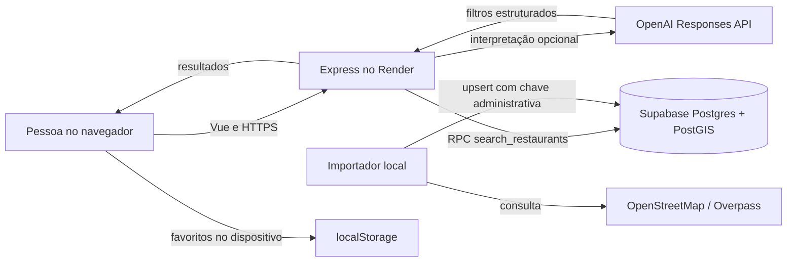

# Arquitetura

## Visão geral

O front-end Vue é compilado pelo Vite e servido pelo mesmo processo Express que expõe a API. A busca de lugares e a leitura da base passam pelo servidor; o navegador não recebe a chave administrativa do Supabase.

## Componentes

### Front-end

- `apps/web/src/App.vue` contém a tela de busca, filtros, resultados, favoritos e detalhes.
- `apps/web/src/style.css` define cores, tipografia, componentes e pontos de quebra para telas pequenas, médias e grandes.
- `apps/web/index.html` define o idioma, metadados e fontes.
- O Vite encaminha `/api` para `http://localhost:3000` no desenvolvimento. Em produção, Express serve `apps/web/dist` e as rotas `/api` no mesmo domínio.

### API

- `apps/api/src/server.js` configura Express, Helmet, CORS, limites de requisição, validação de entradas e endpoints.
- `apps/api/src/restaurants.js` consulta a função `search_restaurants` no Supabase.
- `apps/api/src/ai.js` extrai culinária, orçamento e texto livre. Usa regras locais se a chave da OpenAI não estiver configurada ou se a chamada falhar.
- O modelo não escolhe nem inventa restaurantes. A lista final sempre vem do banco.

### Banco de dados

- `public.restaurants` guarda os lugares, coordenadas PostGIS, metadados da fonte e estado de publicação.
- RLS permite leitura anônima apenas de registros publicados.
- A função `public.search_restaurants` aplica filtros textuais, geográficos, de culinária e orçamento e devolve uma página por chamada.
- A chave `SUPABASE_SERVICE_ROLE_KEY` só é necessária no script de importação e não deve ser colocada no serviço web.

## Fluxo da busca

1. A tela envia os filtros para `GET /api/restaurants` ou a frase para `POST /api/recommend`.
2. A API valida os dados e, se necessário, interpreta a frase.
3. A API chama `search_restaurants` no Supabase.
4. O PostGIS calcula a distância quando latitude e longitude foram fornecidas.
5. A interface apresenta os dados de origem e sinaliza preço e avaliação desconhecidos.

Ao selecionar **Alterar**, o navegador solicita permissão de localização. Se autorizada, as coordenadas são usadas para ordenar e limitar a busca; elas não são gravadas pelo app. Os favoritos são guardados no `localStorage` do dispositivo.

## Segurança e privacidade

- A chave administrativa do Supabase fica fora do front-end e fora do deploy web.
- A API valida parâmetros com Zod e limita o tamanho do corpo JSON.
- Helmet adiciona cabeçalhos de segurança; CORS usa as origens configuradas em `WEB_ORIGIN`.
- A API limita chamadas gerais a 60 por minuto por origem e `/api/recommend` a 10 por minuto.
- Sem login, o app não mantém perfis ou favoritos em servidor.
- Se a integração OpenAI for habilitada, somente a frase digitada é enviada para extrair filtros. Coordenadas de localização são enviadas à API do próprio app para a busca geográfica, não à chamada da OpenAI.
