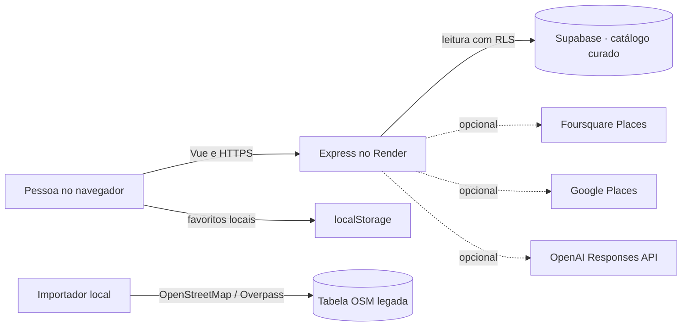

# Arquitetura

## Visão geral

O front-end Vue é compilado pelo Vite e servido pelo processo Express que também expõe a API. No modo padrão, a API lê o catálogo curado do Supabase. Nenhuma chave administrativa do Supabase chega ao navegador.

## Componentes

- `apps/web/src/App.vue`: busca, filtros, seleção, favoritos e detalhe dos restaurantes.
- `apps/web/src/style.css`: identidade visual, pontos de quebra e acessibilidade visual.
- `apps/api/src/server.js`: Express, Helmet, CORS, limites de requisição, validação e rotas.
- `apps/api/src/restaurants.js`: leitura do catálogo curado por padrão; integrações externas apenas quando `RESTAURANT_DATA_SOURCE` seleciona um provedor.
- `apps/api/src/ai.js`: interpreta a frase localmente; pode usar OpenAI se houver chave no servidor.
- `supabase/migrations/20261020212737_curated_restaurant_catalog.sql`: estrutura e semente inicial do catálogo curado.
- `scripts/import-openstreetmap.js`: importador da tabela OSM legada, não do catálogo curado.

## Fluxo da busca

1. O navegador pede `/api/restaurants` ou `/api/recommend` no mesmo domínio.
2. A API valida a entrada e interpreta a frase com regras locais; OpenAI é opcional.
3. No padrão `curated`, a API lê fichas publicadas e revisadas nos últimos 180 dias e combina fotos e itens de menu.
4. A API calcula distância em linha reta somente para locais com coordenadas cadastradas. Sem coordenadas, a distância fica nula.
5. O front-end distingue preço por pessoa de valores de itens do menu, exibe fontes e sinaliza dados ausentes.

Na primeira visita, a interface oferece permitir GPS, buscar por bairro ou continuar sem localização. O navegador só pede localização após um clique. O app usa as coordenadas para a busca e não as grava. Favoritos ficam no `localStorage` deste dispositivo.

## Segurança

- RLS limita a leitura do catálogo a fichas publicadas e verificadas recentemente.
- `SUPABASE_SERVICE_ROLE_KEY` é apenas para operação administrativa local; nunca use no cliente ou no serviço web.
- Helmet aplica cabeçalhos de segurança; Zod valida parâmetros e corpos; rate limits limitam as rotas.
- Chaves de Google, Foursquare e OpenAI permanecem no servidor. As integrações externas estão desligadas no modo `curated`.
- Se OpenAI for habilitada, recebe a frase para extrair filtros; a busca de restaurantes continua sendo feita pelo provedor de dados ativo.
- As páginas `/privacidade` e `/termos` descrevem o tratamento de dados do navegador e as fontes externas opcionais.
